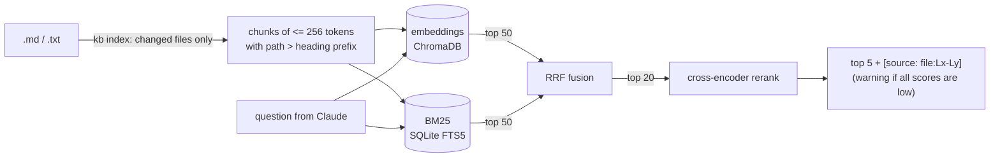

# MCP Knowledge Base


Local search over your markdown docs for Claude, with line-level citations, and an evaluator that tells you how well it works on **your** docs. Runs entirely on your machine; no API keys.


- **Hybrid retrieval** (embeddings + BM25, fused by rank) with a **cross-encoder reranker**.
- **Cited answers**: every chunk comes back as `[source: ops/runbook.md:L8-L14]`.
- **Measured, not claimed**: every component is benchmarked on BEIR with significance tests, and compared head-to-head with [qmd](https://github.com/tobi/qmd) and [knowledge-rag](https://github.com/lyonzin/knowledge-rag): a tie on SciFact, behind qmd on NFCorpus, ahead of knowledge-rag, at a fraction of the latency of both.
- **`kb eval`**: a local LLM writes test questions from your own docs and scores search on them. Validated against human-labelled data.

New here? [docs/START_HERE.md](docs/START_HERE.md) explains the whole project on one page.

---

## Install and try it

```bash
git clone https://github.com/karthikreddyyalala/MCP_Knowledge_Base.git && cd MCP_Knowledge_Base
uv venv && uv pip install -e .

.venv/bin/kb index ./example-docs                          # build the index (later runs only re-index changed files)
.venv/bin/kb search "when does my login token stop working"  # exactly what Claude will see
```

The models (~175 MB) download on first use; after that nothing touches the network. Once published to PyPI as `citekb`, `uvx citekb index ./docs` will work without cloning.

## Connect to Claude

```bash
claude mcp add kb -- $PWD/.venv/bin/kb serve --docs /path/to/your/docs
```

<details>
<summary>Claude Desktop</summary>

`~/Library/Application Support/Claude/claude_desktop_config.json`:

```json
{
  "mcpServers": {
    "knowledge-base": {
      "command": "/absolute/path/to/MCP_Knowledge_Base/.venv/bin/kb",
      "args": ["serve", "--docs", "/path/to/your/docs"]
    }
  }
}
```
</details>

With `--docs`, the server re-indexes added, edited or deleted files each time it starts, so restarting Claude picks up your changes. The index lives in `~/.mcp-kb/chroma` (change with `--db`).

Claude gets two tools: `search_docs(query)` returns the top 5 chunks with citations, and `list_docs()` lists indexed files and pending changes. `.md` and `.txt` files are indexed.

## What Claude gets back

```
[source: deployment-runbook.md:L11-L14]
deployment-runbook > Deployment Runbook > Deploy steps

3. Monitor Datadog dashboard for error rate spike (threshold: >1% over 5 min)
4. If error rate spikes, run rollback: `./scripts/rollback.sh <previous-sha>`
```

If nothing scores as clearly relevant, the results come with a warning ("Low confidence: these may not answer the question") instead of being presented as answers.

---

## Results

Measured on three [BEIR](https://github.com/beir-cellar/beir) datasets. Each document is written to a markdown file and goes through the real `kb index` and search code, so these numbers measure the product. nDCG@10, higher is better; **bold** = significant against the row above (paired randomization test, p < 0.05).

| Setup | SciFact | NFCorpus | FiQA | p95 latency |
|---|---|---|---|---|
| v1: 400-word chunks, dense only | 0.652 | 0.309 | 0.362 | 9 ms |
| 256-token chunks + `path > heading` prefix | 0.659 | 0.321 | 0.356 | 8 ms |
| BM25 alone | 0.685 | 0.323 | 0.241 | 123 ms |
| Hybrid: dense + BM25, RRF | **0.711** | **0.349** | 0.346 | 124 ms |
| **Hybrid + rerank top 20 (default)** | 0.720 | **0.364** | **0.367** | 65–325 ms |

Against v1 that is **+10% on SciFact and +18% on NFCorpus**; FiQA is level. Both baselines match published numbers (MiniLM dense and BM25 within about a point), which is the check that the pipeline is sound.

### Compared with other local tools

Same files, same queries, same scoring; each tool queried through its own MCP server with its default settings.

| | SciFact nDCG@10 | NFCorpus nDCG@10 | p50 latency (SciFact) |
|---|---|---|---|
| [qmd](https://github.com/tobi/qmd) 2.8.3 (LLM query expansion + LLM rerank) | 0.729 | **0.383** | 7.1 s* |
| **kb** (this repo) | 0.720 | 0.364 | **67 ms** |
| [knowledge-rag](https://github.com/lyonzin/knowledge-rag) 4.11.1 | 0.718 | 0.338 | 224 ms |

On SciFact the three are a statistical tie (all pairwise p > 0.5). On NFCorpus, qmd wins (+0.018 over kb, p = 0.02), most likely from rewriting each question with an LLM before searching, at about 85× the latency; kb beats knowledge-rag there (+0.027, p < 0.001). \*qmd's GPU (Metal) backend failed to compile on the test machine's macOS, so its latency here is likely CPU-bound and not representative. FiQA (57k docs) was not run for the other tools: qmd would need hours to embed it on this machine.

### Does `kb eval` tell the truth?

`kb eval` ranks search setups using questions a local LLM writes from your docs. To check it, the same thing was run on BEIR corpora, where human-written questions give the true ranking. Spearman correlation between the two rankings (1.0 = identical order):

| Question writer | SciFact (prompt tuned here) | NFCorpus (held out) |
|---|---|---|
| llama3.2:3b | 0.4 (picked the wrong best setup) | not run |
| qwen2.5:7b, prompt v1 | 0.8 | 0.8 |
| **qwen2.5:7b, prompt v2 (default)** | **0.8** | **1.0** |

### Limits, measured

- **Synthetic questions still favour keyword search a little**: an LLM writing a question from a passage reuses its words. A word-overlap filter and the v2 prompt reduce it; it isn't gone.
- **Relevance scores don't transfer across domains.** A threshold calibrated on BEIR (97% of answerable questions above it) flagged correct answers on short runbook text, such as "undo a bad deployment" (score −8.3 vs −6.57). So the default *warns* below the threshold instead of hiding results; `kb eval --save-threshold` calibrates a hard "not found" on your own docs if you want one.
- **Near-misses are hard.** On-topic questions your docs don't answer often score like answerable ones; the score catches off-topic questions far better.

All numbers, with Recall@10, MRR@10, latency and p-values: [results/summary.md](results/summary.md). How each was produced and what went wrong along the way: [docs/BUILD_LOG.md](docs/BUILD_LOG.md).

---

## Measure it on your own docs

```bash
brew install ollama && ollama serve &   # any OS: https://ollama.com
ollama pull qwen2.5:7b
.venv/bin/kb eval /path/to/your/docs
```

It samples chunks, writes one question each chunk answers and one on-topic question it doesn't, filters out questions that copy the text or that the docs answer elsewhere, then reports hit@5 and MRR@5 for each setup with p-values against the default, a recommendation, and a calibrated threshold. `--review` lets you spot-check questions by hand; `--gold <file>` re-scores a saved set without the LLM.

## How it works



| Decision | Why |
|---|---|
| Chunks sized in real tokens (256) | The embedding model reads 256 tokens and silently drops the rest; v1's 400-word chunks lost about half their text. |
| Hybrid search, fused by rank | Embeddings catch paraphrases, BM25 catches exact names and codes. Their scores are on unrelated scales, so RRF merges by rank. |
| Rerank only the top 20 | A cross-encoder reads question and chunk together: accurate but too slow for everything. 20 tied or beat 50 at half the cost. |
| Warn, don't hide, by default | A wrong "not found" loses a real answer; a flagged weak chunk is something Claude can judge. |
| Incremental sync by content hash | Only changed files are re-embedded; the manifest is written last, so an interrupted sync repairs itself. |
| ChromaDB + SQLite, local models | One install, no accounts, nothing leaves the machine. |

Every concept, file and command is explained in [docs/HOW_IT_WORKS.md](docs/HOW_IT_WORKS.md).

## Privacy and security

- Indexing, search, reranking, `kb eval` and query expansion all run on your machine. No API keys, no telemetry; once the models are cached nothing touches the network.
- The server talks to Claude over stdio and opens no network port. Ollama (optional) listens on `127.0.0.1` only.
- What leaves your machine: the chunks returned for each question become part of your Claude conversation. Don't index anything you wouldn't paste into a chat.
- Retrieved text is read by Claude, so a document containing instructions ("ignore previous instructions...") could influence it. Index only docs you trust.

## Reproduce

```bash
uv pip install -e ".[dev]" && .venv/bin/python -m pytest tests -q   # 68 tests
.venv/bin/kb bench --dataset scifact --setup hybrid-rerank20       # any row; setups in src/mcp_kb/evals/beir.py
.venv/bin/kb validate-eval --dataset nfcorpus                      # the kb eval check (needs ollama)
```

Optional tracing of every search with [Arize Phoenix](https://phoenix.arize.com/): `uv pip install -e ".[tracing]"`, then run `kb serve` with `PHOENIX_ENABLED=1`.
